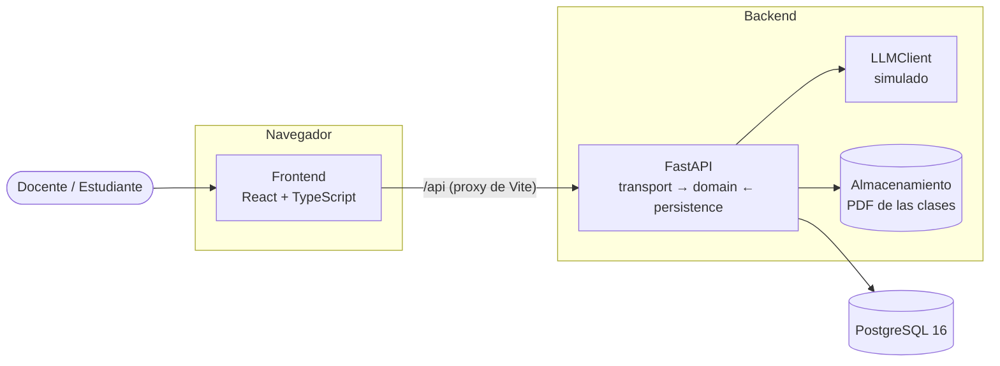
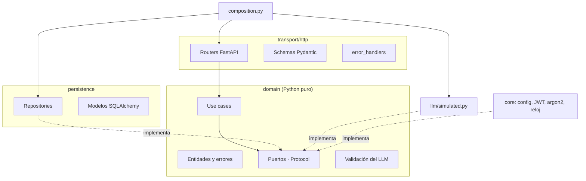
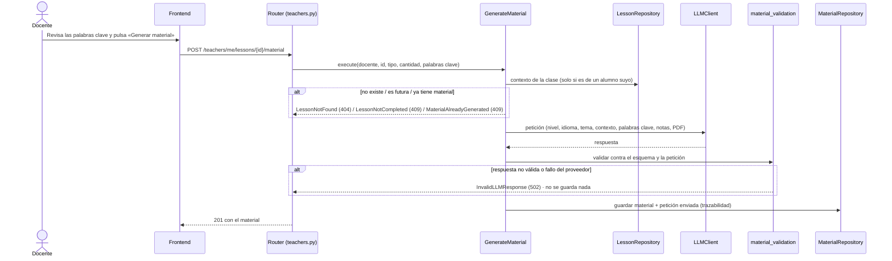
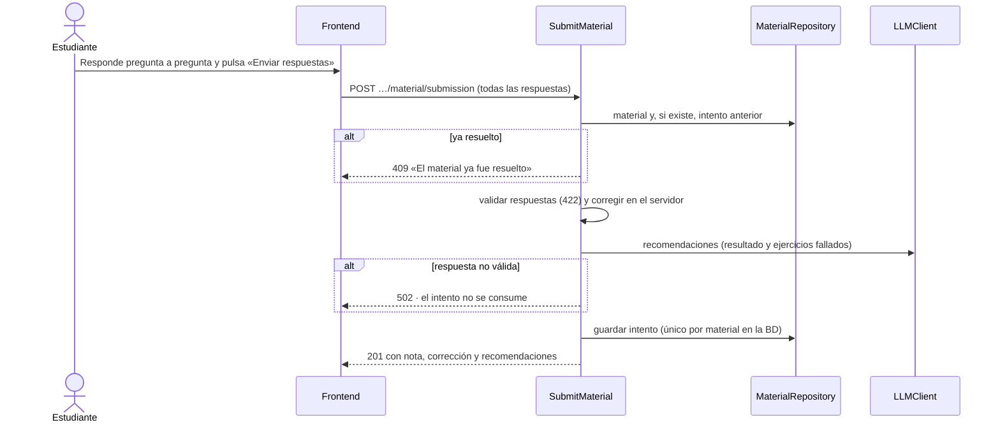
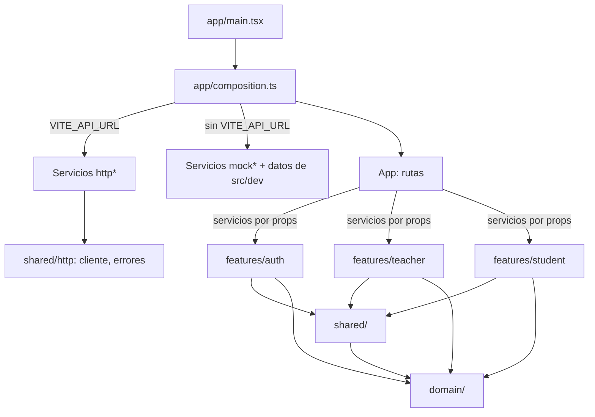
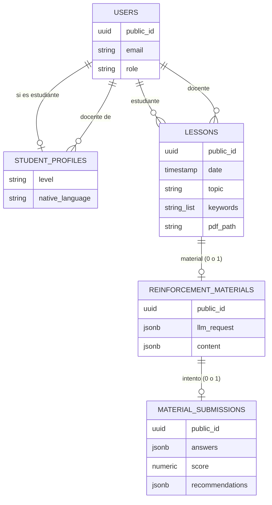
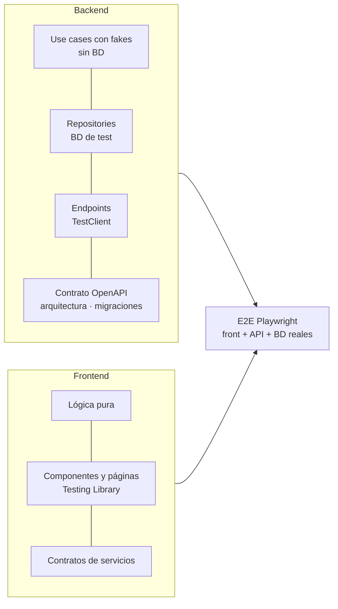

# Arquitectura

Última actualización: 2026-10-18

Cómo está construido PractIcA y por qué. Los requerimientos están en [`001-backend-requirements.md`](001-backend-requirements.md) y [`002-frontend-requirements.md`](002-frontend-requirements.md); las normas de desarrollo, en [`CLAUDE.md`](../CLAUDE.md).

## 1. Visión general

- El **frontend** es una SPA que solo habla con la API. En desarrollo, Vite reenvía `/api` al backend: mismo origen y sin CORS.
- El **backend** expone una API REST (contrato en [`openapi.yaml`](openapi.yaml)), guarda los datos en PostgreSQL y los PDF en disco, y delega la generación de material y recomendaciones en un **LLM** detrás de una interfaz (hoy simulado).
- El frontend también funciona **sin backend**, con servicios en memoria (`src/dev`), para desarrollar y hacer demostraciones.
- En **producción** (`docker-compose.prod.yml`), todo corre en una misma instancia: Caddy sirve el frontend compilado y reenvía `/api` a la API, igual que el proxy de Vite en desarrollo, y además gestiona el HTTPS. Ver el README, sección «Despliegue en producción».

## 2. Backend: tres capas

- **Las dependencias apuntan al dominio** (`transport → domain ← persistence`). El dominio no importa FastAPI, SQLAlchemy ni Pydantic; un test de arquitectura (`tests/architecture/test_layers.py`) falla si alguna capa importa en la dirección prohibida.
- **Dominio**: entidades inmutables (`dataclass(frozen=True)`), errores de negocio, **puertos** (`Protocol`: `UserRepository`, `LessonRepository`, `MaterialRepository`, `LLMClient`, `FileStorage`, `Clock`, …) y **un use case por acción** (`GenerateMaterial`, `SubmitMaterial`, `GetTeacherInsights`, …) con sus dependencias inyectadas y un método `execute`.
- **Persistencia**: un repository por agregado que implementa su puerto y devuelve entidades, nunca modelos. Solo hace `flush`; la transacción es por petición (`get_session` hace `commit` o `rollback`).
- **Transporte**: valida con Pydantic, obtiene el use case por `Depends` y traduce los errores de dominio a HTTP **en un único lugar** (`error_handlers.py`).
- **Composición** (`composition.py`): el único módulo que conoce a la vez persistencia y dominio. Para cambiar una implementación (p. ej. un LLM real) basta con tocar aquí.

### Una petición de principio a fin: generar material

### Resolver el material

## 3. Frontend: features y servicios

- **Por features** (`auth`, `teacher`, `student`): cada una tiene sus páginas en la raíz, sus piezas en `components/` y sus servicios en `services/`. **Las features no se importan entre sí**; lo común está en `shared/` (línea de tiempo, calendario, gráficos, cliente HTTP, formatos) y los tipos y reglas de negocio en `domain/`, que no depende de nada.
- **Servicios intercambiables**: cada servicio es una `interface` con una implementación HTTP y otra en memoria. Ambas pasan el **mismo test de contrato** (`src/test/contracts/`); la HTTP, contra un back falso que responde según `openapi.yaml`.
- **Composición**: `app/composition.ts` es el único lugar que elige implementaciones; `App` las pasa **por props** a las páginas, así que las features no dependen del contexto de `app/` y se prueban con servicios falsos.
- **Los componentes no ven la API**: los servicios HTTP convierten snake_case al dominio (camelCase) y el cliente traduce los errores a `ApiError` (con el `detail` del back) y `NetworkError`.
- **Sesión**: `SessionProvider` recupera la sesión con `/auth/me` y escucha los `401` del cliente HTTP para cerrar la sesión caducada.

## 4. Datos

- Esquema completo en [`backend/migrations/001-esquema-base-de-datos.sql`](../backend/migrations/001-esquema-base-de-datos.sql), generado desde las migraciones de Alembic y verificado por un test.
- Las **restricciones de unicidad** (`lesson_id` en materiales, `material_id` en intentos) garantizan «una sola vez» incluso con peticiones simultáneas.
- Los PDF están en disco (`backend/storage/lessons/<UUID del estudiante>/`) y solo se leen a través del puerto `FileStorage`, protegido contra *path traversal*.

## 5. Seguridad

- **Autenticación**: JWT HS256 de 60 minutos, sin estado; contraseñas con **argon2**. El front guarda el token en `sessionStorage` y cierra la sesión ante un `401`.
- **Autorización** en cada use case: rol y **propiedad** (un docente solo ve a sus alumnos; un estudiante, sus clases). Un recurso ajeno responde `404`, sin revelar que existe.
- **Identificadores públicos**: UUID v4 aleatorios; los ids numéricos de la BD nunca salen de la persistencia.
- **Secretos**: solo en `.env` locales, en el servidor de producción (los `.env` de la instancia) o en secretos de CI, como `SecretStr` y sin valores por defecto; Gitleaks en el *pre-commit* y en CI sobre todo el historial.
- **El estudiante nunca recibe las respuestas correctas** antes de resolver: el schema del material del estudiante no tiene ese campo.

## 6. Calidad y tests

- **TDD** en todo el proyecto: primero un test que falla, después el código mínimo, después el refactor.
- **Tipos**: `mypy --strict` y `tsc` estricto comprueban que cada implementación cumple su contrato.
- **Estilo y complejidad**: ESLint con SonarJS (complejidad ≤ 15, sin literales repetidos ni ternarios anidados) y sin números mágicos.
- **E2E**: Playwright levanta su propia API y su propio front sobre una BD `practica_ia_e2e` que se reinicia en cada ejecución.
- **CI** (GitHub Actions): backend (mypy, pytest con PostgreSQL, `alembic check`), frontend (lint, tests con cobertura, build), E2E y detección de secretos.

## 7. Decisiones

| # | Decisión | Motivo | Alternativa descartada |
|---|---|---|---|
| D1 | Arquitectura en tres capas con puertos y use cases | El dominio (corrección, validación del LLM, reglas de «una sola vez») se prueba sin BD ni HTTP, y las implementaciones se cambian sin tocarlo | Lógica en los routers: más simple al inicio, pero acopla negocio y framework |
| D2 | LLM detrás de la interfaz `LLMClient`, **simulado** | El proyecto no depende de un proveedor ni de su coste; un LLM real es otra implementación en `composition.py` | Llamar a un proveedor desde el use case |
| D3 | **Validar siempre** la respuesta del LLM (cantidad, hueco, opciones, coherencia con las palabras clave) | Un LLM puede devolver contenido incorrecto; mejor un `502` sin guardar nada que material roto para el estudiante | Confiar en la respuesta |
| D4 | Material generado **una sola vez** y resuelto **una sola vez** | El resultado del estudiante debe corresponder a un material estable; la BD lo garantiza con restricciones de unicidad | Regenerar o reintentar (fuera de alcance) |
| D5 | Corrección **en el servidor** y material del estudiante **sin respuestas** | Evita que el estudiante vea o manipule la corrección | Corregir en el cliente |
| D6 | UUID v4 como identificador público | No son secuenciales ni adivinables, y no revelan cuántos recursos hay | Exponer los ids numéricos |
| D7 | JWT sin estado de 60 min, sin refresh tokens | No hay registro ni cambios de contraseña; es lo más simple que cubre el alcance | Sesiones en servidor o refresh tokens |
| D8 | `openapi.yaml` como **fuente de verdad**, verificado por test | Front y back acuerdan la API antes de implementarla; el test detecta cualquier desviación | Documentar la API después de implementarla |
| D9 | Frontend por features con servicios inyectados por props y tests de contrato | Las pantallas se prueban sin red y el front funciona sin back; las implementaciones son intercambiables | Llamar a `fetch` desde los componentes |
| D10 | Proxy de Vite en lugar de CORS | Mismo origen en desarrollo: menos configuración y superficie de ataque | Habilitar CORS en la API |
| D11 | E2E con BD propia que se reinicia | Tests deterministas que nunca tocan los datos de desarrollo (el script se niega a vaciar una BD que no termine en `_e2e`) | Usar la BD de desarrollo |
| D12 | Despliegue en **una sola instancia EC2** con Docker Compose | Dentro de la capa gratuita de AWS, con pocas piezas que mantener; la base de datos, la API y el frontend comparten la misma máquina | RDS + S3/CloudFront: más servicios que configurar y mantener para el alcance actual |
| D13 | **Caddy** como servidor web, con HTTPS automático para un dominio | Certificado de confianza sin gestionarlo a mano y renovación automática; el mismo proxy sirve el frontend y reenvía `/api` | Certificado autofirmado (el navegador avisa) o gestionar Let's Encrypt manualmente con Nginx |
